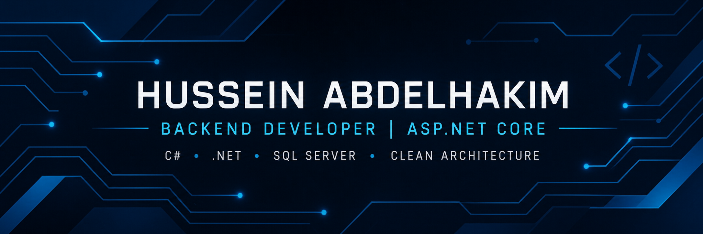

# Hi, I'm Hussein Abdelhakim 👋

  

### Software Engineering Student | Backend Developer

I'm a Software Engineering student at **New Cairo Technological University (NCTU)**, passionate about backend development and building scalable, maintainable web applications.

My primary focus is **C# and ASP.NET Core**, with an interest in software architecture, database design, and modern web technologies.

I enjoy turning ideas into practical applications while continuously improving my programming and problem-solving skills.

---

### 🚀 About Me

- 🎓 Software Engineering Student at NCTU.
- 💻 Focused on Backend Development using C# and ASP.NET Core.
- 🏗️ Interested in Clean Architecture and Software Design Patterns.
- 🌱 Currently expanding my Full Stack Development skills.
- 📚 Always learning and exploring new technologies.

---

### 🛠️ Tech Stack

**Languages**

**Backend Development**

**Frontend Development**

**Database & Tools**

---

### 💻 Featured Projects

#### 🛒 ECommerce API

A RESTful E-Commerce backend built with ASP.NET Core Web API and Clean Architecture.

- ASP.NET Core Web API (.NET 10).
- Clean Architecture.
- Entity Framework Core & SQL Server.
- ASP.NET Core Identity & JWT Authentication.
- Product, Category, Brand, Cart, and Order Management.
- Product Images & Colors Management.
- Stripe Payment Integration.
- Promotions & Discounts.
- Email Confirmation & OTP.
- Repository Pattern.
- Scalar API Documentation.

🔗 [View Repository](https://github.com/HessuinHakim/ECommerce)

#### 📋 TaskFlow – Task Management System

A task management application designed to organize and manage tasks efficiently.

- ASP.NET Core MVC (.NET 10).
- Entity Framework Core & SQL Server.
- ASP.NET Core Identity.
- Authentication & Email Confirmation.
- Task Priorities, Status & Due Date Management.
- Repository Design Pattern.
- SOLID Principles.

🔗 [View Repository](https://github.com/HessuinHakim/TaskManagement)

---

### 📊 GitHub Statistics

---

### 🤝 Connect With Me

---

⭐ Always learning, building, and improving.
